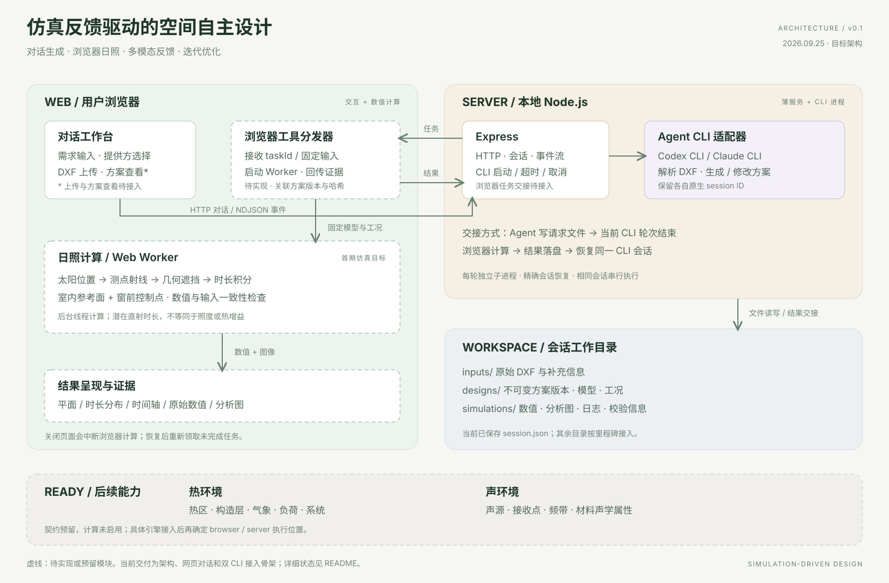

# 工程架构设计

版本：0.1 · 日期：2026-09-25 · 状态：架构基线，按阶段实现。

## 1. 产品范围与已确定决策

项目名：**仿真反馈驱动的空间自主设计**。

用户在网页中上传平面轮廓 DXF，通过自然语言与 Agent 持续对话。Agent 解析图纸、形成可计算方案、发起分析、解释结果，并在约束范围内修改空间。

- 使用一个 Node.js Express 服务承载 HTTP 与本地 Agent CLI。
- 支持 Codex 和 Claude 两个提供方，通过适配器统一事件；一个会话固定一个提供方。
- DXF 解析交给有文件和代码执行能力的 Agent，可调用解析库或编写脚本，不单独建设 DXF 后端服务。
- 首期日照分析在浏览器 Web Worker 内执行，页面主线程负责对话与图形显示。
- 热环境、声环境只预留数据和工具契约；接入引擎后再决定执行位置。
- 首期使用本地文件持久化，暂不引入数据库、Redis、任务队列或微服务。
- UI 首先提供对话与结果查看；交互式 CAD 编辑器属于后续能力。

## 2. 架构图

[可编辑 Mermaid 源文件](diagrams/architecture.mmd)。此图描述完整目标；当前代码完成度见 [README](../README.md)。

## 3. 模块职责

| 模块 | 执行位置 | 职责 |
| --- | --- | --- |
| 对话与文件界面 | Web 主线程 | 需求、附件、消息流、方案选择、结果展示 |
| 浏览器工具分发器 | Web 主线程 | 接收分析任务、加载指定版本、启动 Worker、回传结果 |
| 日照 Worker | Web 后台线程 | 太阳位置、射线遮挡、逐点时长及质量检查 |
| 几何与结果查看器 | Web | 平面预览、三维分析模型、日照图、时间轴 |
| Express | 本机 Node.js | 会话、HTTP、CLI 调用、文件访问与浏览器任务交接 |
| CLI 适配器 | Node.js 子进程 | Codex / Claude 命令构造、原生会话 ID、事件转换、退出管理 |
| Agent | 所选 CLI | 理解需求、解析图纸、布局生成、证据分析、结构化修改 |
| 会话工作目录 | 本地磁盘 | 原图、模型、方案版本、分析设置、结果、对话记录 |

## 4. 两种 CLI 的统一方式

初版每一轮启动一个非交互 CLI 进程，结束后释放。对话连续性由精确的原生会话 ID 保持，不使用全局“最近会话”。

| 提供方 | 首轮 | 后续轮次 |
| --- | --- | --- |
| Codex | `codex exec --json --sandbox workspace-write --skip-git-repo-check -` | `codex exec ... resume --json --skip-git-repo-check <thread_id> -` |
| Claude | `claude -p --output-format stream-json --verbose` | 增加 `--resume <session_id>` |

提示通过标准输入传递。`spawn` 使用参数数组和 `shell: false`，不拼接用户输入为 shell 命令。提供方、可执行文件及模型由受控配置决定。

不同 CLI 输出不同事件，适配为 `session`、`text`、`progress`、`error`、`done`。不向页面转发内部推理块。工具审批沿用 CLI 的有效权限；不自动加入跳过权限或沙箱的参数。

Codex 使用 workspace-write；Claude 首版采用 dontAsk，未授权工具被拒绝，已授权工具可运行。若实际任务需要更多工具权限，应在本地 CLI 的项目权限中配置；Web 审批面板是后续扩展。

跨提供方切换创建新会话。后续可以导入相同方案和摘要，但不能把 Codex thread ID 当成 Claude session ID。

## 5. Agent 怎样调用浏览器

两种 CLI 的命令模式都不能被假定为接受本项目自定义的 `tool_result` 标准输入。首期目标采用**轮次间文件交接**，不要求改造 CLI：

1. Agent 在工作目录中生成模型、配置和 `handoff/request.json`，随后结束当前 CLI 轮次。
2. Express 在 CLI 退出后读取请求，做 schema、路径、版本及能力检查，持久化 pending 记录。
3. Web 获取任务，将指定模型和配置交给 Worker。
4. Worker 返回结构化数值；主线程生成分析图并回传。
5. Express 校验 task ID、方案版本、输入哈希和执行状态，将结果落盘。
6. Express 使用原 CLI 会话 ID 发起新一轮，通知 Agent 读取结果和图片，继续诊断或优化。

因此，一次用户发言可以包含多个 CLI 轮次，但不需要把 CLI 进程永久挂起等待浏览器。未来需要轮次内工具调用时，可用 MCP 或 Codex app-server 扩展，首期不依赖这些组件。

自动续跑受最大轮数、运行时间和用户取消约束。每次继续都必须有新的结果或新输入；不会对同一文件无限重试。

详细字段见 [协议文档](protocol.md)，完整交互见 [时序图](diagrams/sequence.mmd)。当前骨架尚未执行上述浏览器交接与自动续跑。

## 6. 轻量空间模型

`model.json` 是可编辑几何的事实来源，预览图片只是展示。初版使用本地米制坐标，显式记录与朝向、标高的关系。

| 对象 | 最小内容 |
| --- | --- |
| model | schemaVersion、revisionId、parentRevisionId、units、坐标约定 |
| floor | 边界、楼层标高、层高、顶部和底部遮挡 |
| space | ID、边界、用途、目标面积与性能偏好 |
| wall | ID、几何、厚度、高度、固定/可修改属性 |
| opening | ID、宿主墙 ID、位置、尺寸、填充构件引用 |
| door / window | ID、洞口 ID、几何、启闭及分析属性 |
| fixedContext | 柱、结构墙、楼梯、电梯井、管井等已知固定条件 |
| externalContext | 周边建筑、挑檐、阳台等遮挡及其数据来源 |

房间 ID 与构件 ID 保持稳定；拆分、合并记录来源映射。每次修改保存新目录，原方案不覆盖。面积、相邻、可通行等基础检查作为模型合法性检查，不另做仿真模块。

DXF 导入由 Agent 处理图层、块变换、单位、闭合轮廓与构件识别。未能识别的信息标记缺失或采用显式假设。轮廓图不包含的窗高、层高、地理信息必须补齐后才能开始对应日照分析。

## 7. 日照计算

首期计算的是给定时段内的**潜在直射日照时长**，不是照度、太阳辐射能量、全年采光或实际天气下的观测日照。不计云量和漫射反射；门窗透光与框体遮挡采用记录在配置中的几何假设。

### 输入

- 方案版本、三维遮挡几何、透光开口；顶部/楼板不能遗漏。
- 经纬度、IANA 时区、日期、当地分析时段、建筑朝向；记录转换后的 UTC 时间。
- 室内参考面和窗前控制点、测点间距、参考面高度、时间步长。
- 项目定义的目标时长/区间与目标空间；不默认所有空间日照越多越好。

### 算法

1. 统一坐标、检查模型与测点。
2. 按时间段采样，计算太阳方向；太阳低于地平线的时段计为无直射。
3. 用固定的分析网格建立空间加速结构，对测点作射线遮挡查询。
4. 按每个采样区间的实际时长积分，得到每个点的累计时长和时间段。
5. 按测点代表面积统计空间指标，生成时长图及选定时刻的阴影图。

可采用 Three.js 几何与 BVH 射线查询。Worker 执行数值计算，主线程负责渲染；从渲染阴影图片反推数值不是首期算法。

### 输出与质量

保存原始逐时可见性、测点坐标、累计时长、房间指标、配置、引擎版本及图片。候选方案使用相同工况、采样规则和目标版本。窗外条件固定时，仅优化窗前日照不足以驱动室内布局，必须包含室内指标。

基准包括：无遮挡点、无窗封闭空间、已知遮挡、窗框与顶板、自遮挡；检查时区/朝向及步长细化后的误差。固定测点、太阳和透光规则下，新增不透明遮挡不应增加日照。

Agent 读取数值与图像进行一致性分析、提出原因假设，再用修改后的重新计算验证。大模型判断不能替代数值与基准验证。

## 8. 页面与进程生命周期

| 情况 | 目标行为 |
| --- | --- |
| 同一会话同时收到两条消息 | 串行执行或返回 busy；不让两个 CLI 同时修改目录 |
| 浏览器关闭/Worker 被终止 | 日照任务进入 waiting_browser 或 interrupted，不承诺继续计算 |
| 页面重新打开 | 加载会话及 pending 任务；用户恢复后重新领取，不重复接收旧结果 |
| 旧方案结果晚到 | 保留在对应历史版本，不能替换当前方案结果 |
| 网络重试提交相同结果 | 以 task ID 幂等接收；内容不同的重复提交拒绝 |
| CLI 失败/权限拒绝/超时 | 显示明确错误，保留输入；不把失败标为仿真成功 |
| Express 重启 | 从磁盘恢复会话，运行中任务标记 interrupted；不宣称内存任务自动恢复 |

当前对话骨架：客户端断开会终止本轮 CLI，已写入会话的消息可重新加载；浏览器任务生命周期待下一阶段实现。

## 9. 热环境与声环境 ready

这里的 ready 指**能力命名、输入输出边界、数据扩展位置和执行器接口已预留**，不表示求解器可运行。

| 能力 | 输入扩展 | 输出扩展 | 执行位置 |
| --- | --- | --- | --- |
| sunlight | 地点、时序、开口、测点 | 日照时长与可见性 | browser |
| thermal | 构造层、热区、气象、负荷、系统与运行条件 | 温度、负荷、舒适性 | 后续按引擎确定 |
| acoustics | 声源、接收点、频带、吸声散射属性 | 脉冲响应、混响等 | 后续按引擎确定 |

室内混响与房间间隔声分别定义能力。日照的二值可见性不能直接当作热环境的太阳得热。

共用结果信封，专业数据使用各自 schema。未实现能力返回 `CAPABILITY_NOT_IMPLEMENTED`，不生成假指标。

## 10. 本地运行边界

一个 Node 进程同时提供网页和 API，默认仅监听 127.0.0.1。CLI 在独立会话目录启动，继承本地有效登录与权限；文件夹隔离不是沙箱。外部部署和多用户权限不属于当前版本。

对话、工具进度和结果使用明确事件传递。上传文件和 Agent 输出均按数据处理，前端用 textContent 展示文本；图片与下载通过受控文件入口提供。浏览器不得提交任意可执行命令或 CLI 参数。

## 11. 技术依据

- [Codex 非交互模式](https://developers.openai.com/codex/noninteractive/)：JSONL 事件及精确会话恢复。
- [Claude Code 程序化调用](https://code.claude.com/docs/en/headless)：print、stream-json 和会话继续。
- [Claude CLI 参数](https://code.claude.com/docs/en/cli-reference)：CLI 参数与权限模式。
- [Node.js 子进程](https://nodejs.org/api/child_process.html)：异步进程与输入输出。
- [Web Workers](https://developer.mozilla.org/en-US/docs/Web/API/Web_Workers_API)：浏览器后台线程。
- [three-mesh-bvh](https://github.com/gkjohnson/three-mesh-bvh)：射线与空间查询加速。
- [Direct Sun Hours](https://docs.ladybug.tools/hb-radiance-primer/components/3_recipes/direct_sun_hours)：日照时长及逐时可见性，可用于后续交叉验证。

具体 CLI 参数同时以开发机 `--help` 核对；不同安装版本可能需要适配。
