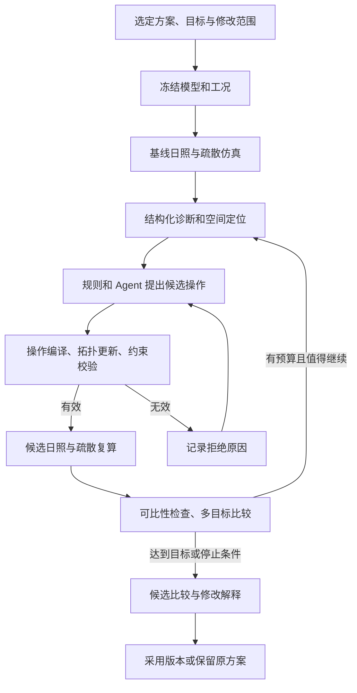

**仿真驱动空间更新：产品与工程设计提案**

2026-10-04。依据当前工作区源码整理；本文是待实施设计，不代表下面的能力已实现。用户已选定第一阶段为“局部改造”：在既有单层空间内，保持外轮廓与固定条件，通过受约束的局部操作改善性能。有限自动迭代仍只在这个范围内搜索；整体布局重排作为后续独立能力，不纳入首期验收。

**1. 交付目标**

用户提出“改善卧室日照，同时缓解出口拥堵，尽量少改墙”，系统应交付：

- 可定位到房间、墙、洞口的问题，以及支持问题的仿真数据。
- 至多三套有明确差异的候选平面，每套都能解释改了什么、为什么改。
- 同一工况下的前后指标、改造量、未满足目标和结果可信范围。
- 可采用、可回退、可继续迭代的方案版本。

核心职责分开：Agent 提出设计假设；确定性程序执行空间操作和校验；仿真引擎产生数值证据；比较器决定是否改善；用户选择采用方案。开始优化一次后，系统在约定范围与预算内自动生成、校验和复算，无须逐个候选确认。

**2. 当前代码提供了什么**

| 环节 | 当前实现与复用入口 | 新增工作 |
| --- | --- | --- |
| 草图还原 | `server/src/sketch/runSketchTurn.ts`、`compile.ts`：墙、洞口、空间、识别报告 | 为优化补充尺度、结构角色、真实边界等适用性检查 |
| 空间模型 | `shared/src/model.ts`：稳定对象 ID、allocationId、fixed、role、父版本 | 明确对象编辑权限、功能身份和拆分合并映射 |
| 方案生成与修改 | `server/src/design/runSpaceTurn.ts`、`compileLayoutPlan.ts` | 增加局部操作编译器；现有全量布局编译继续服务生成/重排 |
| 日照 | `server/src/sunlight/run.ts`、`shared/src/sunlight.ts`：测点、面积加权指标、目标检查 | 统一调度、输入冻结、诊断与候选对比 |
| 人流 | `server/src/pedestrian/run.ts`、`shared/src/pedestrian.ts`：疏散时间、密度、轨迹 | 固定人口工况、可达性检查、稳定出口标识、重复试验 |
| 展示 | `web/src/App.tsx`、Viewer、日照与人流面板 | 优化入口、问题定位、几何差异、候选比较 |
| 存储 | `designs/<rev>/`、`simulations/<task>/` | 优化任务、证据链、显式采用版本、断点状态 |

README、早期 architecture/roadmap 的部分描述已落后于源码。实施以当前服务端 Python 引擎路径为准，不再围绕浏览器 Worker 建立优化调度。

当前人流配置只接受 `scenario: egress`，不能直接代表日常使用流线。当前日照关注直射日照时长，不能用这个数值代替照度或热舒适。Honeybee 对 Direct Sun Hours 的定义也是传感器网格接收直射阳光的小时数。[官方说明](https://docs.ladybug.tools/hb-radiance-primer/components/3_recipes/direct_sun_hours)

**3. 用户操作流程**

1. 选择现有方案，点击“根据仿真优化”，也可用自然语言发起。
2. 在同一面板中选择主要目标、不可退化项、可修改对象和改造幅度。系统复用现有工况，明确哪些参数来自默认示例。
3. 系统检查关键输入，冻结基线并运行或复用有效仿真；页面显示问题位置及证据。
4. 自动尝试局部修改，显示“正在评估第 2 个候选”，可随时停止，已完成结果保留。
5. 展示“少改动”“日照优先”“疏散优先”等实际存在的候选。若它们不能体现不同取舍，不强行凑足三套。
6. 用户点击候选查看原方案/新方案、变化高亮及指标；点击“采用”才变更项目采用版本。“继续优化”明确以当前选中候选为父版本。

布局建议与识别修正保留独立入口：修正草图中的误识别不应被计为性能改善；识别基线变化后重新建立可比较基线。

**4. 优化任务先明确目标、约束、变量和预算**

使用独立 `OptimizationSpec`，不要把可执行约束全部塞进自由文本或 `performancePreferences`。

| 内容 | 设计要求 |
| --- | --- |
| 基线 | `baseRevisionId`、模型内容哈希、识别来源、采用版本 |
| 工况 | 日照地点/日期/朝向/时段/测点规则；疏散人数/行为模型/出口策略/种子集合 |
| 目标 | 指标 ID、对象范围、方向、目标值、优先级、最小有意义改善量 |
| 硬约束 | 锁定构件、外轮廓、最小面积/净宽、必需功能、可达性、人口守恒 |
| 不可退化项 | 如卧室日照达标面积比例不得低于基线，或退化不得超过用户设定范围 |
| 操作范围 | 允许操作、对象白名单、参数上下限、最大修改构件数量 |
| 预算 | 候选数、迭代轮次、Agent 调用数、仿真次数、总耗时、进程并发上限 |
| 采用策略 | 默认展示候选由用户采用；自动迭代不隐含自动替换采用方案 |

优化前只解决影响当前计算/修改的缺项：

- 无真实尺寸时，可以预览，但不能比较物理门宽、面积和疏散时间；应补尺度。
- 草图墙当前默认 `fixed:false, role:unknown`，不能由此推导“允许移动”。未知墙默认不进入可修改白名单，明确标记为可改的隔墙才允许操作。
- 默认城市、朝向、人数需作为假设清楚呈现。示例工况可以用于探索，但结果应标记为假设条件下的结论。
- 几何、仿真输入、编辑权限分别检查；不因一个无关识别 warning 阻止所有工作，也不通过关闭全局人工复核绕过物理尺度要求。
- 外轮廓必须代表有效建筑区域。草图编译中的包围盒用途需要与实际建筑/可行走边界区分，不能让包围盒空白自动成为通行区域。

**5. 闭环架构**



所有回路共享任务预算，几何错误修正也消耗预算。某个候选失败不让完整任务失败；基线输入无效、关键求解器不可用则明确结束或等待所需输入。

新增 `server/src/optimization/` 作为编排层，通过函数调用既有编译器、求解器及 ProviderAdapter。首期继续采用单 Node 服务、本地文件和受限子进程池，无需引入数据库和分布式队列。

**6. 从结果产生诊断，先区分观察与原因假设**

增加派生 `SpatialGraph`：节点为物理空间、逻辑功能和室外；边分别表示相邻、门洞连通、开放通道和外窗关系；边关联墙/洞口 ID、净宽、方向和限制。图是从模型生成的索引，不成为另一份手工维护的几何。

诊断记录包含 `issueId`、对象引用、空间位置、指标、任务证据引用、严重程度，以及待验证的原因假设。

| 数值观察 | 原因假设 | 可尝试操作 | 如何验证 |
| --- | --- | --- | --- |
| 卧室目标日照覆盖不足 | 隔墙阻挡部分入射路径 | 小幅移动已允许修改的隔墙 | 重算该卧室及全体受保护空间日照 |
| 低日照区承担高日照需求功能 | 功能位置与日照场不匹配 | 满足面积、邻接和设施约束后交换功能 | 目标随功能身份迁移，检查所有原有需求 |
| 门前出现高密度 | 门洞宽度限制、汇流或出口选择导致排队 | 门位/门宽变化、局部通道调整 | 同人数、同策略下重算轨迹、密度和清空时间 |
| 起点到出口不可达 | 连通路径缺失 | 新增被允许的内部门洞 | 先做图与净空检查，再跑疏散 |

现有日照结果没有直接给出“是哪面墙造成遮挡”的证据。首期可以用邻接关系缩小候选范围，并通过单项小幅扰动试算验证假设；后续再增加逐时遮挡物 ID。密度热点也不直接证明某个门宽是原因。

保持原始结构化数据。给 Agent 的上下文包含局部几何、可修改对象、指标摘要、相关热力图和失败尝试；无需每轮发送所有轨迹点。几何定位与数值事实以数据为准，解释文字保留“观察 / 假设 / 复算结论”的区别。

**7. 用领域操作执行空间更新**

新增 `DesignPatch`，以稳定对象 ID 和有界参数表达操作。服务器实施操作，不让优化流程任意重写完整模型。

| 操作 | 第一阶段范围 | 校验和联动 |
| --- | --- | --- |
| `resizeOpening` | 改变允许修改的门洞宽度 | 宿主权限、端部余量、相邻洞口、净通行宽度 |
| `moveOpening` | 门洞沿宿主墙移动 | 门两侧仍连接正确空间、无重叠、出口语义不变 |
| `offsetPartition` | 已确认隔墙的小幅偏移，先支持简单直线墙 | 相邻墙交点、两侧房间、宿主洞口、面积、连通性同步更新 |
| `swapProgram` | 交换满足条件的功能分配 | 面积、设施、邻接、目标和人员随功能需求迁移 |
| `resizeWindow` / `moveWindow` | 后续，显式允许修改的外窗 | 立面范围、宿主与结构权限、窗台和窗顶高度 |
| 新增门洞、拆合分区、整体重排 | 后续阶段 | 更完整的拓扑编辑和功能映射 |

门洞可修改不等于其宿主墙可开洞；墙位置固定也不必然代表既有门洞尺寸固定。锁定策略按属性分开表达，默认采用较窄的已知编辑范围。

示意协议，数值仅用于说明结构，不是本项目规范值：

```json
{
  "schemaVersion": "1",
  "baseRevisionId": "rev-0003",
  "baseModelHash": "sha256:...",
  "reasonIssueIds": ["issue-door-queue-01"],
  "operations": [
    {
      "id": "op-1",
      "type": "resizeOpening",
      "openingId": "opening-7",
      "expectedWidthM": 0.9,
      "widthM": 1.1,
      "anchor": "center"
    }
  ]
}
```

Patch API 统一米制，入口处将模型的 m/mm 转换；保留来源单位映射。应用时校验基线哈希和前置值，在独立副本上执行整个操作组；失败则整组拒绝。成功后输出新模型、拓扑、实际 diff、来源映射和校验记录，再分配/提交候选版本。

保留未变化对象的 ID。逻辑功能使用稳定 `allocationId` 或独立的 program ID；物理空间拆分合并输出 lineage，人员与日照目标不能因为更名丢失。功能交换时目标绑定功能需求，几何原址评价则另存空间维度指标。

现有 `compileLayoutPlan.ts` 对 layout-v2 构件采用全量提交，并保留旧开口及宿主墙；它不能直接承担以上精确局部操作。也不要把“没有目标构件”解释为“请求删除”，或通过给所有既有对象打 generatedBy 标记来解除保护。可提取共享拓扑/洞口校验函数，保持两条编辑路径的语义清楚。

**8. 仿真指标和多目标选择**

| 目标 | 首期使用已有数据 | 需要新增的能力 |
| --- | --- | --- |
| 日照 | 每个功能区的 meanHours、minHours、targetMetRatio、sampledArea | 指定评价区域、采样覆盖检查、可选多日期工况 |
| 疏散 | 全体清空时间、平均离开时间、出口峰值密度、瓶颈、轨迹 | evacuated/remaining 数、稳定出口引用、人员离开时间分布、固定密度采样规则 |
| 低改造量 | 从模型 diff 计算移动/新增/删除墙长度、改门窗数量、面积变化 | 获得实际单价后再计算费用；首期只是改造量代理 |
| 空间可用性 | 现有几何、面积、覆盖校验 | 净宽、起点到出口可达性、必需邻接及锁定属性校验 |

当前日照 `verification` 混合了目标满足状态；人流正常输出默认 `needs_review`，即使 `status:completed` 也可能 `egressTimeSec:null`。因此新增统一评价层，分别记录：执行成功、输入适用、数值完整、设计约束满足、性能目标满足。未达到日照目标仍可作为可比较候选，未清空则不能因均值较低被判为更优。

当前模拟从人员已经开始运动算起。产品将时间称为“给定工况下的模拟清空时间”，不直接把它解释为涵盖所有响应阶段的完整疏散时间。

比较按以下顺序执行：

1. 确认工况、目标、人口与评价范围可比；关键值缺失不能按零处理。
2. 淘汰越界、破坏锁定条件、丢失必需功能、无法通行等候选。
3. 执行不可退化约束；基线原有缺陷可设为改善目标，但不能通过人口减少等方式消除。
4. 对剩余候选保留多目标非劣解，即不存在另一候选在所有目标上都不差、且至少一项更好。
5. 按用户指定的主目标排序，次级考虑改造量，展示原始单位和前后差值。加权评分如需使用，只用于偏好排序，不能抵消硬约束。

例如，同一工况下 A 少改墙、日照略有改善；B 日照改善较多、改造量较大；C 疏散改善更多。这三者可以同时保留。不把多项物理量直接相加，也不默认所有空间日照越多越好。

**9. 保证前后比较成立**

- 日照工况的地点、日期、时段、朝向、外部遮挡、精度与目标不随候选改变。目标空间映射随稳定功能 ID 解析，不能删除低分空间获得高分。
- 初期统一采样精度；网格采用固定世界坐标锚点及裁切规则，记录 sampledArea 和有效覆盖。边界变化时不能逐索引相减两张不同网格，只对共同区域重采样显示差值，新增/删除区域单独显示。
- 若后续增加粗算筛选，最终基线和候选必须全部使用同一精细设置复算，不把粗细结果直接排名。
- 人口以冻结的功能需求/负荷保存。候选面积变化后不调用 defaultAgents 重新生成较少人数；拆分合并须保持总人数，并记录分配规则。确需变更人口则创建新的比较任务。
- 疏散初筛采用固定种子，候选复核采用相同的一组种子。不同几何下同种子不等于同一组物理起点，因此同时冻结采样规则，并报告重复试验的中位数、范围及失败次数。
- 初期可配置少量重复运行作为稳定性筛查；若波动与候选差值相当，应增加运行次数或标记改善不确定，不能据少量样本承诺统计显著性。
- 记录引擎实际版本、代码/依赖指纹、精度、工况和目标版本。缓存依据完整输入内容，不能只看 revisionId。

停止条件：目标达到；预算耗尽；用户停止；没有有效操作；连续两轮没有超过设定容差的改善。最后一种默认值可配置。每次停止都给出原因，返回已经完成的候选。没有改善就保留基线，并说明哪些约束限制了搜索。

**10. 生成与搜索策略**

第一阶段采用“诊断规则定位 + Agent 选策略 + 程序枚举少量参数”。如同一可改门洞试两个宽度，同一隔墙试两个方向的小位移。每个候选尽量只包含一个操作或一个不可拆的拓扑操作组，便于验证因果。

第二阶段保留少量不同方向的优良候选进行有限轮次搜索；所有版本标明父版本，并分别比较“相对本轮父版本”和“相对固定初始基线”的变化。对重复模型哈希去重，几何失败原因反馈给下一轮，避免重复尝试。

第三阶段再允许离散拓扑变化与整体重排。届时根据实际变量数量和仿真成本评估参数优化算法，首期不依赖复杂优化框架。

建议试运行默认值：每轮最多 3 个新候选、最多 2 轮、共享 10 分钟时间预算；Agent、仿真总次数另有上限。这些是保护交互耗时的可调初值，需用实际运行耗时校准，不是性能承诺。任务调度应预留最终复核预算，不能把全部预算用在生成候选上。

**11. 任务、存储和恢复**

建议新增契约：

- `OptimizationSpec`：基线、目标、约束、范围和预算。
- `SimulationScenarioSet`：逻辑工况、目标和各候选的明确空间映射。
- `Diagnosis`：观察、证据、原因假设和建议操作。
- `DesignPatch`：有前置条件的领域操作。
- `CandidateEvaluation`：模型/工况/引擎引用、原始指标、增量、质量、硬约束、排名与解释。
- `OptimizationRun`：任务状态、候选索引、预算消耗、事件游标和停止原因。

```text
workspaces/<session>/
  designs/<revision>/
    model.json
    validation.json
    patch.json
    lineage.json
  simulations/<task>/
    model.frozen.json
    config.frozen.json
    envelope.json
    result.json
    runner.log
  optimizations/<run>/
    spec.json
    baseline.json
    state.json
    events.ndjson
    diagnoses/<iteration>.json
    candidates/<candidate>/evaluation.json
    comparison.json
  selection.json
```

逻辑工况哈希与求解输入哈希分开：不同候选的物理空间 ID 映射可不同，但需要证明它们对应相同功能需求、人口和参数。结果引用至少包含 session、run、candidate、revision、模型哈希、逻辑工况哈希、求解输入哈希、task 和实际引擎指纹。

状态可用 `queued → preflight → baseline → diagnosing → proposing → validating → simulating → comparing → completed`；循环回 proposing/diagnosing。另有 `needs_input`、`cancelled`、`failed`、`interrupted`。是否找到了更好的方案单独存为 outcome，不能用 completed 代替“有改善”。

- 开始任务返回 202 和 runId；事件流只订阅状态，不承担任务生命周期。
- 页面断开不取消后台任务；显式取消传播 AbortSignal，终止求解器及其子进程，保留产物。超时与预算限制执行相同的清理。
- 服务重启把运行中任务标为 interrupted；恢复前核验输入和已完成产物，只补未完成任务。
- 对同一会话的版本分配、设计写入和采用指针串行化；候选 Agent 使用独立任务上下文，不共享会产生相互污染的原生会话。
- 只读的已冻结候选仿真可以受限并发。原子创建版本目录和写文件，不能依赖扫描目录得到 nextRevisionId 后无锁并发写入。
- adopted/active、可预览、几何有效、满足性能目标是不同状态。当前 edit 回退到最新 valid 版本的行为需要调整，防止新生成的候选意外成为后续修改基线。
- 采用请求携带 expectedActiveRevisionId / 内容哈希；用户已修改当前方案时返回版本冲突，不静默覆盖。

首期缓存可以用完整规范化模型内容哈希，允许重复计算但不冒险误复用。后续仅在引擎适配器声明依赖、并有失效测试后，才对与该引擎无关的元信息做缓存投影。

建议 API：

| 接口 | 用途 |
| --- | --- |
| `POST /api/optimizations` | 创建并运行任务，带幂等键 |
| `GET /api/optimizations/:runId` | 获取状态与候选摘要 |
| `GET /api/optimizations/:runId/events` | 带游标恢复的进度流 |
| `POST /api/optimizations/:runId/cancel` | 显式取消 |
| `POST /api/optimizations/:runId/resume` | 补齐输入或恢复中断任务 |
| `GET /api/optimizations/:runId/comparison` | 指标、证据和几何差异 |
| `POST /api/optimizations/:runId/adopt` | 采用已完成候选，检查版本前置条件 |

路由复用现有 session/路径校验；候选生成与传统 edit 都要经过同一版本协调机制。

**12. 前端呈现**

保持现有聊天与 Viewer，在仿真面板增加“根据结果优化”；新增三个主要视图：

- 目标面板：主目标、保护指标、可修改范围、幅度和预算。锁定对象在图上可视化。
- 诊断视图：点击问题定位到空间/构件，显示指标与原因假设，支持只处理某一问题。
- 比较视图：固定原方案作为基线，同视角、同热力图色标比较；高亮新建、删除、移动构件，配合候选指标表。

候选卡片示例文案结构：“调整一处门洞；模拟清空时间变化 X；卧室日照变化 Y；修改两处构件；仍有 Z 未满足”。所有数值从 evaluation 读取，未知值显示未评估。

仿真图和结果按 revision + modelHash + scenarioHash 绑定。旧请求晚到时只写其对应结果存储，不能覆盖当前 Viewer。选择历史版本能读取历史结果，不依赖页面内存里的最近一次 run。

**13. 自动优化前优先处理的代码差距**

以下来自源码检查，未在此次设计工作中运行真实引擎复现：

1. 两个 `run.ts` 都写入 frozen 输入，但 Python 的参数仍指向设计目录里的原文件。改为实际读取冻结文件，确保 inputHash 与求解输入一致；为运行器增加取消、超时和非零退出码处理。
2. `updateDesignFloor` 会就地修改同一 revision。优化任务应绑定不可变快照；后续用户模型编辑逐步改成新 revision，至少根据内容哈希使旧结果失效。
3. `SKETCH_HUMAN_REVIEW_ENABLED=false`，草图分支存在专门的放行路径。新增独立的优化适用性检查，不把“能显示”直接等同于“可物理比较”。
4. 固定构件保护需从外轮廓/fixed 墙几何，扩展到已声明锁定的高度、厚度、角色、开口、固定上下文和外部遮挡。结构/未知角色与编辑白名单统一处理。
5. 日照默认配置来自示例，人流默认人数按 targetArea 生成。基线建立后冻结工况；候选不重新套默认值。targets 未配置时允许查看原始日照指标，但优化目标必须在 spec 中明确。
6. 人流几何目前对 MultiPolygon 只取最大连通区；优化检查不能默默丢弃有人或目标所在的区域。先验证所有起点到允许出口可达，不支持的多区域场景应明确报告。
7. 人流 Python 几何入口未看到 m/mm 归一化；在共享适配层统一米制，并用等价单位案例验证。出口当前用顺序 exit-N 标识，应映射到稳定 openingId。
8. 当前人流出口目标按欧氏距离选择，密度采样配置隐含在引擎中。比较需固定策略并记录参数；改空间不能暗中换策略。复杂流线后续按可行走路径/明确 journey 建模。JuPedSim 将路径任务表示为 stages 与 transitions 组成的 journey，且这些目标必须位于有效可行走区域。[官方路由说明](https://www.jupedsim.org/stable/concepts/routing.html)
9. 对准备优化的动作补足引擎适用性：当前人流障碍主要来自 walls，门扇开启角等字段尚不等于真实行为建模，固定设施也需确认是否转入障碍。不能优化求解器实际忽略的属性后宣称性能改变。

**14. 实施拆分与验收**

| 阶段 | 具体产物 | 可验收结果 |
| --- | --- | --- |
| A：建立可信比较 | 冻结输入、适用性检查、统一运行器、可取消任务、基线指标和稳定对象映射 | 同一模型与工况可重放；旧结果不覆盖新版本；人口/目标不丢失 |
| B：完成一个局部闭环 | 先做门宽/门位操作、连通与权限校验、候选版本、两仿真复算、比较与采用 | 从疏散问题定位到门洞改动，再验证疏散改善及日照不退化；无改善也可正确返回 |
| C：让日照驱动修改 | 隔墙小位移、房间边界联动、功能交换、日照诊断 | 日照目标驱动真实几何/功能变化，面积和疏散保护项通过 |
| D：有限自动迭代 | 多候选搜索、非劣解、重复试验、停止/恢复、几何差异视图 | 一次请求产生可解释的多目标候选，预算与中断行为可验证 |
| E：扩展场景 | 外窗、布局重排、日常流线；按明确输入再接热/声模块 | 每个新动作或新仿真都有可比指标、适用范围和回归案例 |

建议新增文件边界：

```text
shared/src/optimization.ts
shared/src/designPatch.ts
server/src/optimization/{run,store,preflight,diagnose,propose,evaluate,compare}.ts
server/src/simulation/{runner,adapters,snapshot}.ts
server/src/design/{applyDesignPatch,spatialGraph,validateEditConstraints}.ts
server/src/routes/optimizations.ts
web/src/components/{OptimizationPanel,CandidateComparison,OptimizationProgress}.tsx
web/src/viewer/designDiff.ts
```

验证重点覆盖真正的失败风险：

- Patch 原子性；移动墙后门洞/相邻空间联动；固定构件与未知墙不能被误改；m/mm 等价。
- 同工况比较中目标功能、评价范围和人口守恒；删除低分房间或减少人数不能刷分。
- 未清空、缺少测点、引擎失败、不可达、目标未满足彼此区分。
- 哈希与实际求解输入一致；迟到结果、重复提交、同时编辑、取消和服务重启行为正确。
- 基准空间包括可改善案例、冲突取舍案例、完全锁定无可行修改案例。
- 自动化协议测试用模拟引擎覆盖状态边界；改善结论必须另用真实日照/人流引擎与固定工况验证，不能用模拟返回值代替。

首个演示可以选“两房一廊、一个可修改门洞、明确日照目标”的小空间。验收应能完整追溯“哪个问题 → 哪个操作 → 哪版模型 → 哪组输入 → 哪次复算 → 哪项改善”，并在约束下无解时如实返回原方案。
